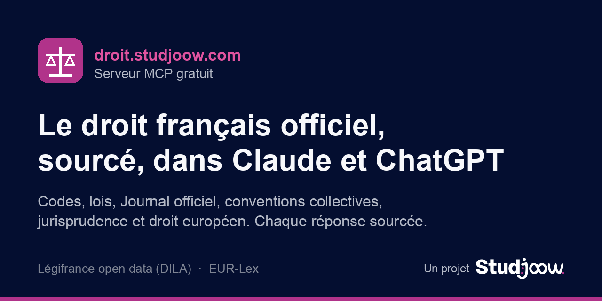

<div align="center">

[](https://droit.studjoow.com)

# Droit français sourcé : serveur MCP pour Claude et ChatGPT

**Le droit français et européen officiel dans votre assistant IA, chaque réponse sourcée article par article.**

Codes, lois, Journal officiel, conventions collectives, jurisprudence (Conseil d'État, Cour de cassation, Conseil constitutionnel, CNIL) et droit de l'Union européenne (EUR-Lex), en données ouvertes. Essai gratuit sans inscription, abonnement à 4,99 € par mois, ou auto-hébergement gratuit : le code est libre, l'hébergement est clé en main.

[](https://droit.studjoow.com)
[](https://modelcontextprotocol.io)
[](https://echanges.dila.gouv.fr/OPENDATA/)
[](LICENSE)
[](https://studjoow.com)

**[droit.studjoow.com](https://droit.studjoow.com)** · [Ajouter en 30 secondes](#en-30-secondes) · [Tarifs](#tarifs) · [Outils](#les-12-outils) · [Héberger soi-même](#héberger-son-propre-serveur) · [FAQ](#questions-fréquentes)

</div>

---

## Pourquoi ce projet

Les assistants IA répondent souvent sur le droit de mémoire : articles renumérotés, versions périmées, arrêts inventés. Ce serveur MCP les oblige à **chercher dans les textes officiels avant de répondre** et à **citer chaque source** : identifiant Légifrance ou CELEX, lien direct et date de la version utilisée. Un outil de vérification signale toute référence introuvable ou toute citation qui ne figure pas mot pour mot dans le texte.

Exemple de réponse attendue :

> L'article 1240 du Code civil pose le principe de la responsabilité pour faute : « Tout fait quelconque de l'homme, qui cause à autrui un dommage, oblige celui par la faute duquel il est arrivé à le réparer » (Code civil, art. 1240).
>
> **Sources**
> Code civil, art. 1240 (version du 2016-10-01 à ce jour, VIGUEUR) [LEGIARTI000032041571] https://www.legifrance.gouv.fr/codes/article_lc/LEGIARTI000032041571

> **Information juridique, pas conseil.** Les réponses résument ce que disent les textes et les décisions. La version qui fait foi est celle publiée sur [Légifrance](https://www.legifrance.gouv.fr) ou [EUR-Lex](https://eur-lex.europa.eu). Pour un cas concret, consultez un avocat.

## En 30 secondes

Adresse publique (essai gratuit) : **`https://droit.studjoow.com/mcp`** (sans authentification). Abonnés : coller à la place l'adresse personnelle `https://droit.studjoow.com/mcp/<clé>` reçue après le paiement.

### Dans Claude (claude.ai, application de bureau ou mobile)

1. Ouvrir **Paramètres**, puis **Connecteurs**.
2. Cliquer sur **Ajouter un connecteur personnalisé**.
3. Nom : `Droit français` ; URL : `https://droit.studjoow.com/mcp`. Pas d'authentification.
4. Dans une conversation, activer le connecteur et demander : « Que dit l'article 1240 du Code civil ? »

### Dans ChatGPT

1. Ouvrir **Paramètres**, puis **Applications et connecteurs**.
2. Selon l'offre, activer le **mode développeur** dans les paramètres avancés.
3. **Créer** un connecteur : nom `Droit français`, URL `https://droit.studjoow.com/mcp`, authentification **aucune**.
4. Dans une conversation, choisir le connecteur dans le menu des outils.

### Dans un client MCP local (Claude Code, Cursor, VS Code...)

```json
{
  "mcpServers": {
    "droit-francais": { "type": "http", "url": "https://droit.studjoow.com/mcp" }
  }
}
```

Avec Claude Code : `claude mcp add --transport http droit-francais https://droit.studjoow.com/mcp`

## Ce que contient la base

| Domaine | Sources | Détail |
|---|---|---|
| Législation consolidée | LEGI | Codes, lois, ordonnances, décrets, arrêtés, **toutes les versions datées** de chaque article |
| Journal officiel | JORF | Textes tels que publiés au JO |
| Conventions collectives | KALI | Conventions, accords et avenants, recherche par **IDCC** |
| Juridictions administratives | JADE | Conseil d'État, cours administratives d'appel, tribunaux administratifs |
| Juridictions judiciaires | CASS, INCA, CAPP | Cour de cassation (publiés et inédits), cours d'appel |
| Contrôle de constitutionnalité | CONSTIT | Décisions du Conseil constitutionnel (DC, QPC...) |
| Protection des données | CNIL | Délibérations de la CNIL |
| Droit de l'Union européenne | EUR-Lex (API Cellar) | Règlements et directives en vigueur (version consolidée), traités, Charte des droits fondamentaux, arrêts de la Cour de justice et du Tribunal, en français |

Les bases françaises sont reconstruites à partir des dumps officiels de la DILA et mises à jour **chaque nuit** avec les fichiers incrémentaux publiés par la DILA. L'outil `etat_base` donne la date du dernier incrément appliqué.

## Les 12 outils

| Outil | Rôle |
|---|---|
| `lire_article` | Texte d'un article de code ou de loi à une date donnée (« Code civil », « 1240 », « 2020-01-01 ») |
| `rechercher_loi` | Recherche plein texte dans LEGI, KALI, JORF ou tout, à une date donnée |
| `lire_texte` | Fiche et plan d'un texte : identifiant, NOR, IDCC ou nom |
| `lister_codes` | Liste des codes |
| `rechercher_jurisprudence` | Décisions par mots, juridiction, formation, numéro de pourvoi, ECLI ou dates |
| `lire_decision` | Texte intégral d'une décision |
| `verifier_references` | Contrôle qu'une référence existe et qu'une citation y figure mot pour mot |
| `lire_texte_ue` | Acte de l'UE article par article (CELEX, « RGPD », « règlement (UE) 2024/1689 ») ou arrêt (« C-131/12 ») |
| `rechercher_droit_ue` | Recherche plein texte dans les règlements, directives, traités et la Charte |
| `rechercher_jurisprudence_ue` | Recherche dans les arrêts de la CJUE et du Tribunal |
| `analyser_conformite` | Pré-analyse de conformité d'un projet (RGPD, cookies, vente en ligne, abonnements, IA, DSA, droit d'auteur...) : obligations probables, question à vérifier et texte à lire pour chacune |
| `etat_base` | Comptes et date de mise à jour de chaque base |

### Protocole de sourçage imposé au modèle

1. Chercher avant de répondre, jamais de mémoire.
2. Croiser la loi applicable et la jurisprudence qui l'interprète.
3. Prendre la version du texte en vigueur à la date des faits.
4. Vérifier chaque référence avec `verifier_references` avant de la citer.
5. Citer la source juste après chaque affirmation : (Code du travail, art. L1237-1), (Cass. soc., 12 juillet 2023, n° 21-21.185), (RGPD, art. 17), (CJUE, C-131/12).
6. Terminer par un bloc « Sources » avec identifiants et liens.
7. Dire clairement ce que la base ne contient pas.

## Tarifs

| Offre | Prix | Ce qui est inclus |
|---|---|---|
| Essai | 0 € | 20 appels d'outils par jour et par IP sur l'adresse publique, sans inscription |
| Abonnement | 4,99 € / mois, sans engagement | Adresse personnelle, 500 appels d'outils par jour (usage personnel), résiliable à tout moment : [s'abonner](https://droit.studjoow.com/abonnement) |
| Auto-hébergé | 0 € | Code libre (MIT), vos serveurs et vos bases : [voir plus bas](#héberger-son-propre-serveur) |

Le code est libre, l'hébergement est clé en main : l'abonnement paie le serveur, les 33 Go de bases indexées et leur mise à jour chaque nuit. Conditions : [CGV](https://droit.studjoow.com/cgv), [confidentialité](https://droit.studjoow.com/confidentialite), [mentions légales](https://droit.studjoow.com/mentions-legales).

## Limites

- Service **sans garantie** de disponibilité continue ni d'exhaustivité ; il peut être lent sur les recherches larges.
- Limite anti-abus de **60 requêtes par minute** (par IP, ou par adresse personnelle pour les abonnés).
- Jurisprudence **non exhaustive** : seules les décisions diffusées en open data y figurent. Les cours d'appel (CAPP) s'arrêtent fin 2023. Environ 17 000 délibérations CNIL n'ont pas de texte (non communicables). Une partie des arrêts du Tribunal de l'UE n'existe pas en texte français. Quelques dates aberrantes existent dans les sources (ex. 2999-01-01).
- Les versions consolidées du droit de l'UE n'ont **pas de valeur officielle**.
- **Information juridique, pas conseil.**

## Skill Claude Code (bases locales, hors ligne)

Le même moteur fonctionne en local, sans serveur, comme skill Claude Code :

```bash
git clone https://github.com/JohnJackHouzi/droit-francais-skill ~/.claude/skills/droit-francais
cd ~/.claude/skills/droit-francais
python3 -I scripts/install.py          # télécharge, construit, supprime les XML, base par base
python3 -I scripts/build_eu.py         # droit de l'UE, périmètre de départ (quelques Mo)
python3 -I scripts/etat.py             # état des bases
```

Prévoir environ **30 Go** pour les bases finales et **40 Go libres** pendant la construction. Les scripts n'utilisent que la bibliothèque standard de Python. Les bases vont dans `~/droit-francais-data/` (variable `DROIT_DATA`). `SKILL.md` décrit le protocole de réponse et toutes les commandes (`search_legi.py`, `search_juri.py`, `search_eu.py`, `verify.py`, `update_legi.py`, `update_juri.py`).

## Héberger son propre serveur

```bash
docker compose up -d --build
curl http://localhost:8000/health     # 503 tant que les bases ne sont pas prêtes, 200 ensuite
```

Au premier démarrage, le conteneur télécharge les dumps DILA un par un dans le volume `/data`, les indexe, supprime archives et XML après chaque base et s'arrête si l'espace libre passe sous 15 Go. Prévoir **80 Go libres** et quelques heures, ou envoyer des bases déjà construites (voir plus bas). Les incrémentaux DILA sont ensuite appliqués chaque jour à 3 h UTC.

| Adresse | Rôle |
|---|---|
| `/mcp` | Serveur MCP (Streamable HTTP, sans état) |
| `/mcp/<clé>` | Adresse personnelle d'un abonné (si l'abonnement Stripe est configuré) |
| `/` | Page d'accueil (mode d'emploi, état des bases) |
| `/health` | État des bases en JSON : 200 si prêtes, 503 sinon |
| `/ping` | Sonde de vie du conteneur |
| `/llms.txt` | Résumé pour les moteurs de réponse IA |

| Variable | Défaut | Rôle |
|---|---|---|
| `DROIT_ALLOWED_HOSTS` | vide | Domaine(s) public(s) acceptés, ex. `droit.exemple.fr` (protection DNS rebinding) |
| `DROIT_PUBLIC_URL` | `https://droit.studjoow.com` | Adresse publique utilisée par la page d'accueil |
| `DROIT_RATE_PER_MIN` | 60 | Requêtes par minute et par IP |
| `DROIT_CONCURRENCY` | 2 | Recherches exécutées en parallèle (protège les autres services de la machine) |
| `DROIT_TRUSTED_PROXIES` | 1 | Nombre de proxys devant le serveur (IP lue dans `X-Forwarded-For`) |
| `DROIT_AUTO_INSTALL` | 1 | 0 : ne pas télécharger les dumps (bases envoyées par rsync) |
| `DROIT_AUTO_UPDATE` | 1 | 0 : pas de mise à jour quotidienne |
| `DROIT_UPDATE_HOUR_UTC` | 3 | Heure de la mise à jour quotidienne |
| `DROIT_MIN_FREE_GO` | 15 | Seuil d'arrêt de l'installation |

Un serveur auto-hébergé est **illimité par défaut** : l'essai et l'abonnement ne s'activent que si les trois variables `DROIT_SECRET`, `DROIT_STRIPE_SECRET_KEY` et `DROIT_STRIPE_WEBHOOK_SECRET` sont renseignées.

| Variable (abonnement, facultatif) | Rôle |
|---|---|
| `DROIT_SECRET` | Secret de 64 caractères hexadécimaux : dérive les adresses personnelles et sale les IP de l'essai. Le changer invalide toutes les adresses |
| `DROIT_STRIPE_SECRET_KEY` | Clé secrète Stripe (ou clé restreinte) |
| `DROIT_STRIPE_WEBHOOK_SECRET` | Secret du webhook `https://<domaine>/stripe/webhook` (événements `checkout.session.completed`, `customer.subscription.updated`, `customer.subscription.deleted`, `invoice.payment_failed`) |
| `DROIT_STRIPE_PRICE_ID` | Prix Stripe mensuel ; vide : prix créé à la volée depuis `DROIT_PRIX` |
| `DROIT_STRIPE_PORTAL_CONFIG` | Configuration du portail client Stripe (`bpc_...`) ; vide : le serveur crée la sienne au premier usage et la garde en base |
| `DROIT_PRIX` / `DROIT_ESSAI_PAR_JOUR` / `DROIT_PLAFOND_ABONNE` | `4,99` / `20` / `500` (appels d'outils par jour et par abonné) |
| `DROIT_RESEND_API_KEY` / `DROIT_EMAIL_FROM` | Envoi de l'adresse personnelle et des liens d'accès par Resend |
| `DROIT_MEDIATEUR` | Coordonnées du médiateur de la consommation affichées dans les CGV |

Les abonnés sont dans `/data/abonnes.sqlite` (jamais dans Git) : seule l'empreinte SHA-256 de chaque adresse personnelle y est stockée, et les compteurs d'essai (IP hachées) sont purgés au bout de 2 jours.

**Envoyer des bases déjà construites** plutôt que de les construire sur le serveur (conseillé sur une petite machine) :

```bash
rsync -a --partial --inplace legi.sqlite juri.sqlite eu.sqlite serveur:/chemin/du/volume/
```

puis démarrer avec `DROIT_AUTO_INSTALL=0`.

## Questions fréquentes

**Qu'est-ce qu'un serveur MCP ?**
Le Model Context Protocol est un standard ouvert qui permet à un assistant IA (Claude, ChatGPT, Cursor...) d'appeler des outils externes. Ici, ces outils interrogent les bases officielles du droit français et européen.

**Les réponses sont-elles fiables ?**
Chaque référence peut être vérifiée par `verifier_references`, qui signale une référence introuvable ou une citation absente du texte. Cela réduit fortement les inventions, sans remplacer la lecture du texte officiel ni l'avis d'un professionnel.

**Mes questions sont-elles enregistrées ?**
Non. Le serveur ne garde aucun historique des questions. Pour l'essai, il conserve seulement une empreinte non réversible de l'adresse IP et un compteur par jour, supprimés au bout de 2 jours. Détails : [politique de confidentialité](https://droit.studjoow.com/confidentialite).

**Pourquoi payer si le code est libre ?**
L'abonnement paie l'hébergement clé en main : serveur, 33 Go de bases indexées, mises à jour quotidiennes de la DILA et maintenance. Héberger son propre serveur reste gratuit.

**Puis-je l'utiliser dans un produit ?**
Le code est sous licence MIT. Les données restent soumises à la Licence Ouverte 2.0 (DILA) et aux conditions de réutilisation d'EUR-Lex. Pour un usage intensif, hébergez votre propre serveur.

## Sources et licences

- Données françaises : **DILA**, Légifrance open data (LEGI, JORF, KALI, JADE, CASS, CAPP, INCA, CONSTIT, CNIL), [echanges.dila.gouv.fr/OPENDATA](https://echanges.dila.gouv.fr/OPENDATA/), sous **Licence Ouverte 2.0** (Etalab).
- Droit de l'Union : **EUR-Lex**, Office des publications de l'Union européenne, via l'[API Cellar](https://op.europa.eu/fr/web/cellar).
- Les bases construites sont des données dérivées soumises aux mêmes licences ; elles ne sont pas incluses dans ce dépôt.
- Code : licence **MIT** (voir [`LICENSE`](LICENSE)).
- Ce projet n'est ni édité ni approuvé par la DILA, Légifrance ou l'Union européenne.

## Un projet Studjoow

<a href="https://studjoow.com"><picture><source media="(prefers-color-scheme: dark)" srcset="docs/logo-studjoow-blanc.svg"></picture></a>

Conçu et maintenu par **[Studjoow](https://studjoow.com)**, studio créatif et tech : sites sur mesure, branding, IA, SEO et GEO. Une idée, un bug, un besoin d'intégration du droit dans votre produit : [ouvrez une issue](https://github.com/JohnJackHouzi/droit-francais-skill/issues) ou contactez le studio via [studjoow.com](https://studjoow.com).
